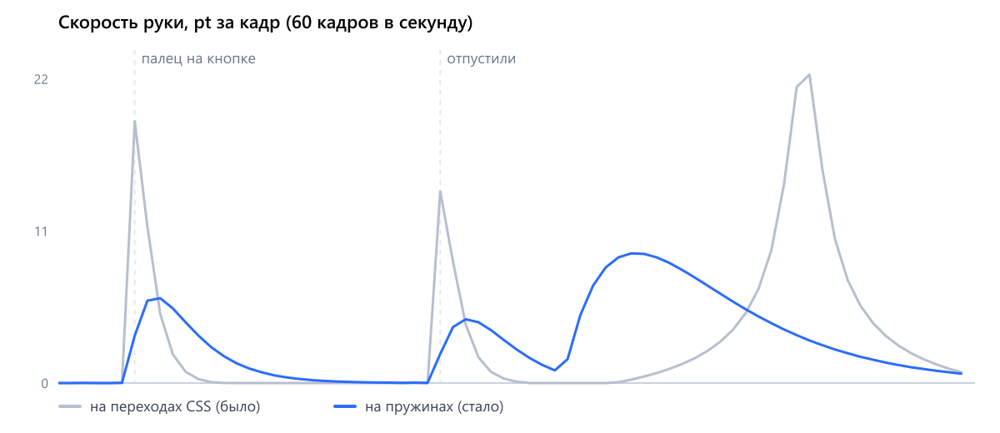

# Ориентиры на каждый день

Два экрана приложения для снижения веса: настройка ориентиров на день с живой иллюстрацией и статистика дня, которая отвечает на вопрос «что мне сделать сегодня». iPhone 15, чистые HTML, CSS и JS, без библиотек.

- **Весь сценарий:** https://kloserock97-tech.github.io/keep-course/
- **Сразу статистика:** https://kloserock97-tech.github.io/keep-course/?screen=stats
- **Сразу экран «Цели»:** https://kloserock97-tech.github.io/keep-course/?screen=goals
- **Ролик первого экрана, 9:16, 15 с:** [media/motion.mp4](media/motion.mp4)

## Экран 1. Ориентиры на каждый день

Шторка поверх профиля: «Настроим ориентиры на каждый день?» На картинке человек бежит по дороге к флажку, вдоль дороги стоят цели: миска, бутылка воды, столбики активности, кроссовок, весы, луна.

**Идея: цели с картинки проходят с человеком весь путь настройки.** В продукте «Продолжить» не настраивает цели сразу: сначала крутится загрузка, потом открывается анкета из 8 шагов (параметры, активность, вес, питание, шаги, вода, расход калорий, сон), в конце — «Ваши ежедневные цели настроены». Анимация повторяет эту логику:

1. **«Продолжить».** Вместо пустой загрузки цели срываются с картинки и встают в полоску шагов анкеты — каждая в деление своего шага: весы в «Желаемый вес», миска в «Питание», кроссовок в «Шаги», бутылка в «Воду», столбики в «Активность», луна в «Сон», флажок — в конец. Дорога с картинки становится путём настройки.
2. **Анкета.** Шаги листаются как экраны iOS, деления заполняются.
3. **Финал.** Цели выходят из своих делений и собираются в картинку «Ваши ежедневные цели настроены».
4. **«Отлично».** Анкета гаснет, под ней профиль, и цели падают в свои значки «Мои цели» — теперь, когда они действительно настроены. «Мои цели» открывают экран «Цели» с карточками.

Текст и обе кнопки стоят на месте с первого кадра шторки. Ничего не нужно пережидать.

### Картинка — слои исходной иллюстрации

Исходных слоёв иллюстратора в макете нет: на экране лежит одна плоская картинка. Поэтому слои нарезаны из неё самой (`tools/layers.mjs`) — так, как их отдал бы иллюстратор для анимации:

- **фон без предметов** — нейросеть LaMa дорисовала то, что было за бегуном и целями: холмы, дорогу, землю в той же манере;
- **бегун из пяти частей** — голова, корпус, рука, передняя нога с подошвой, задняя нога;
- **цели** — миска, бутылка, столбики, кроссовок, весы, флажок отдельно от полотнища;
- **край каждого слоя** посчитала нейросеть ViTMatte по подсказке из масок, а цвет полупрозрачного края очищен от прежнего фона.

Обе нейросети работают локально и бесплатно. В покое сцена — это пиксели исходника: собранные обратно слои отличаются от него в среднем на 3,6 из 255, это сжатие и края. Луна дорисована в той же манере: сна на исходной картинке не было.

Сцена разложена на три слоя: фон, вуаль проявления и подвижные части. Двигаются только лёгкие слои.

**Акцент на целях.** Фон чуть приглушён по насыщенности (на 8 %), цели и бегун — в цветах оригинала. Сильнее приглушать не стал: важнее сходство с исходником.

**Без обрезки.** Края сцены растворяются в белом маской, прямоугольника картинки не видно ни в покое, ни на входе.

### Появление

Шторка поднимается, а внутри разворачивается маленькая история «бегун прокладывает путь к целям»:

1. **Кадр раскрывается.** Сцена начинает с приближения ×1,12 вокруг бегуна и расширяется до полного кадра за время всего появления.
2. **Бегун бежит.** Каденс 0,62 с: корпус дважды за шаг проседает, рука и ноги ходят навстречу друг другу.
3. **Мир проступает следом за бегуном.** Картинку закрывает белая вуаль, в ней мягкие круглые окна. Окна раскрываются по очереди — от ног бегуна вдоль дороги к флажку, — поэтому сначала появляется земля, потом дорога уходит вперёд, и холмы с платформами проступают по мере её хода.
4. **Цели вырастают, когда волна до них доходит.** Каждая растёт из своей точки опоры: по высоте быстрее, чем по ширине, — вытягивается и садится. В этот миг у её плеча вспыхивает жёлтая искра. Последними встают флажок, который тут же полощется, и луна.
5. **У флажка бегун переходит на шаг и встаёт.** Дальше он неподвижен.

Ход волны ведёт всё остальное: цели растут по её положению, а не по таймерам, поэтому ничего не рассинхронизируется.

### После появления

- **Покой.** Бегун стоит. Цели едва покачиваются, флажок полощется. Через 2,4 с и дальше раз в 7 с проходит волна-намёк: цели подпрыгивают с искрой от флажка к ближним, в конце приподнимается кнопка.
- **Палец на «Продолжить».** Цели чуть вырастают, всё остальное отступает в прозрачность, бегун встаёт «на старт», кнопка проседает.
- **Увели палец** — всё возвращается.
- **Отпустили.** Бегун толкается вперёд (свой такт, 200 мс). Шторка раскрывается на весь экран (460 мс) и становится анкетой: сверху проступают «Назад», крестик и полоска шагов. Цели срываются с картинки и по дуге летят вверх, наклоняясь по ходу движения и уменьшаясь до 16 pt. Садясь в своё деление, цель сплющивается в мазок и впитывается, а деление прорисовывается из точки посадки: толстым синим мазком, который вытягивается, утончается и остывает до цвета деления. Цели садятся слева направо, поэтому полоска прорисовывается как дорога на картинке. Первый шаг всплывает, когда цели уже сели.
- **Нажали посреди появления** — сцена быстро дособирается и сразу переходит к полёту.
- **Закрыли анкету на середине** — цели возвращаются на картинку, значки в профиле остаются пустыми, «Мои цели» снова открывает шторку.
- **Последний «Далее».** Полоска гаснет, открывается экран успеха с той же картинкой, что в продукте: пьедестал, бутылка воды, миска, весы, гантель, листик. Пьедестал проступает, предметы с шагом 80 мс падают на свои места и приседают от удара. Весы, приняв вес, взвешивают: стрелка качается и успокаивается. Миска села — авокадо в ней качнулось. Гантель села — конфетти. Следом поднимаются заголовок, текст и карточки.
- **На экране успеха.** Предметы живут по одному, по кругу: бутылка делает сальто, гантель подпрыгивает с перекатом, авокадо качается в миске, весы снова взвешивают. Первый трюк через 1,4 с, дальше раз в 2,6 с, одновременно двигается только один предмет. Листик всё время покачивается. Тени на пьедестале живут с предметами: в прыжке тень меньше и бледнее.
- **«Отлично».** Анкета гаснет, предметы с картинки по дуге падают в свои значки «Мои цели»: миска в «Питание», бутылка в «Воду», гантель в «Активность», весы в «Вес». Шагам и сну на картинке предметов нет, их значки заливаются в свой черёд. Значок принимает цель: заливается синим и коротко вздрагивает. Рядом появляется «Настроены по вашим данным».
- **Дальше.** «Мои цели» открывает экран «Цели» с карточками, статистика дня — во вкладке слева. «В другой раз» и крестик закрывают шторку.

### Кривые и время

Всё движение — на пружинах: при смене цели пружина сохраняет скорость, поэтому нет рывков на стыках. Пара чисел: время отклика в секундах и доля затухания (1 — без перелёта).

| Что | Отклик, с | Затухание | Движение |
| --- | --- | --- | --- |
| Шторка входит | 0,50 | 1 | как системная шторка на iOS; затемнение привязано к её положению |
| Шторка уходит | 0,42 | 1 | уход быстрее входа |
| Кадр раскрывается | 1,60 | 1 | масштаб 1,12 → 1 вокруг бегуна |
| Волна проявления | 1,40 | 1 | ход 0 → 1 от бегуна к флажку; каждое окно раскрывается плавной ступенькой за 18 % хода |
| Цель, ширина | 0,42 | 0,62 | 0,5 → 1 с лёгким перелётом |
| Цель, высота | 0,30 | 0,55 | 0,3 → 1, быстрее ширины: вытягивается и садится |
| Бег гаснет | 0,55 | 1 | у флажка, когда дорога прошла 86 % |
| Подскок в волне | 0,34 | 0,55 | 7 pt |
| Флажок | 0,45 | 0,12 | толчок — и полощется, затухая сам |
| Палец на кнопке | 0,24 | 1 | цели 1,06, кнопка 0,97 |
| Бегун «на старт» | 0,30 | 1 | присед, наклон, рука назад |
| Толчок | 0,34 | 0,78 | рывок вперёд по дороге |
| Полёт вниз / вбок | 0,46 / 0,60 | 0,90 / 0,86 | падение быстрее сдвига: путь — дуга |
| Значок принимает цель | 0,30 | 0,45 | вздрагивает на 5–6 % |

Искра идёт не на пружине, а по времени: ей не к чему приходить — только вспыхнуть и погаснуть. Живёт 0,62 с: размер по полуволне синуса, поворот на четверть; вторая искра меньше и на 0,1 с позже.

**Откуда искры.** Перед доработкой посмотрел в Mobbin, как устроены экраны целей и празднований в приложениях про привычки и здоровье: [Finch — награда за неделю](https://mobbin.com/flows/06c82412-8f84-4bda-acda-e9bb065ca508), [BitePal — настройка целей](https://mobbin.com/flows/240d794c-1df2-459c-b295-5ef878eb37a1), [Gentler Streak — онбординг](https://mobbin.com/flows/8d4fa57c-1176-4557-8d5c-4d241bfdf9d4), [Beli](https://mobbin.com/flows/05cb4c71-c57c-49c3-94b2-cbb1f1f75345) и [Numo](https://mobbin.com/flows/4f17a940-d4f7-4961-a8a2-91c03a9ff309) — серии. Общее у них: полученная награда коротко вспыхивает звёздочкой или светом, прогресс заполняется по порядку. Звёздочку взял, потому что искры в той же манере уже нарисованы у флажка и миски. Ореолы и блик по кнопке пробовал и убрал: на светлой картинке ореол читается как дымка, а свечения и блики спорят с текстом за внимание.

**Шторка или полный экран.** По гайдлайнам iOS шторка — для короткой задачи или запроса информации, а для многошаговых сценариев Apple советует полноэкранное модальное окно ([Sheets](https://developer.apple.com/design/human-interface-guidelines/sheets), [Modality](https://developer.apple.com/design/human-interface-guidelines/modality)). Вопрос «Настроим ориентиры?» — короткий, ему место в шторке. Анкета из 8 шагов — длинная, ей место на весь экран, так что продукт здесь прав. Но гайдлайны же запрещают держать модальное окно поверх модального: первое закрывают, прежде чем показать второе. Поэтому анкета не накрывает шторку и не выезжает после неё отдельным окном. Шторка сама раскрывается в полный экран и становится анкетой: одно окно, одно движение. У анкеты по правилам Apple «Назад» ведёт на прошлый шаг, а крестик закрывает весь сценарий. Жеста «смахнуть вниз» у полноэкранного окна нет, его нет и здесь.

**Конфетти.** Они есть в продукте на этом экране, и это заслуженный момент: человек прошёл 8 шагов, цели настроены. Убирать их значило бы спорить с продуктом без причины. Но в продукте их много и они летят поверх текста, а задача просит, чтобы анимация не отвлекала от текста и кнопки. Поэтому конфетти тише: 64 штуки вместо плотного облака, только синие, один залп из верхних углов, 2,2 с. И они лежат позади заголовка, текста и карточек: празднуют, но ничего не закрывают. При «уменьшить движение» конфетти нет.

**Картинка экрана успеха.** В макете её нет, в продукте она есть только как плоская картинка. Её я сгенерировал в Figma AI по описанию кадра из записи продукта: та же композиция и предметы. Затем разрезал на слои так же, как картинку с бегуном (`tools/success-layers.mjs`): ViTMatte считает края, LaMa дорисовывает фон под предметами. Верх оранжевого пьедестала под гантелью залит отдельно, ровным цветом с тем же зерном: туда дорисовка тащила тень. Стрелка весов стёрта с циферблата и нарисована вектором, чтобы качаться. Запечённые тени тоже стёрты, вместо них — свои мягкие пятна, которые живут с предметами.

| Что | Время | Движение |
| --- | --- | --- |
| Шторка раскрывается в анкету | 460 мс, `--ease-drawer` | верх 50 → 0 pt, скругление 24 → 0 |
| Цель впитывается | пружина 0,16 / 1 | сплющивается до 18 % высоты, гаснет за 200 мс |
| Деление прорисовывается | 560 мс | ширина 0 → 114 % → 100 %, толщина ×2,6 → 1, синий → цвет деления |
| Предмет падает на пьедестал | 0,55 с | падение 21 pt с разгоном, затем присед: шире на 12 %, ниже на 16 % |
| Весы взвешивают | 1,5 с | стрелка −50° → 0 затухающим колебанием |
| Сальто бутылки | 1,15 с | подлёт 38 pt, оборот 360° с плавным разгоном и торможением, присед |
| Прыжок гантели | 0,85 с | подлёт 21 pt с наклоном 10°, присед |
| Авокадо качается | 1,3 с | ±16°, затухает |
| Листик | 3,4 с, по кругу | ±8° и ±1,6 pt |
| Конфетти | 2,2 с | тяжесть 900 pt/с², гаснут последние 0,8 с |

Почему без рывков: ничего не появляется рывком — окна вуали растушёваны и раскрываются внахлёст, цели стартуют с масштаба 0,3–0,5; прозрачность и масштаб идут вместе; соседние элементы перекрываются по времени; у каждого движения своя скорость в зависимости от размера (земля и кадр медленнее, мелкие цели быстрее).

При системной настройке «уменьшить движение» сцена сразу стоит собранной, шторка появляется без подъёма, анкета открывается без полёта, на финале цели уже стоят, после «Отлично» значки заполняются сразу.

Параметр `?slow=4` замедляет всё движение вчетверо.

### Как передать в разработку

- Слои лежат отдельными файлами (`assets/goals/plate.webp`, `assets/goals/l-*.webp`, координаты — в `src-assets/layers/layers.json`) и переносятся в Rive или Lottie как есть. Если у иллюстратора есть исходник со слоями, его стоит подставить вместо нарезки: края и фон за бегуном будут ещё точнее.
- Пары «отклик и затухание» переносятся как есть: в SwiftUI это `Spring(duration:bounce:)`, где `bounce = 1 − затухание`; в Android Compose — `spring(dampingRatio, stiffness)` с жёсткостью `(2π / отклик)²`.
- Состояния: профиль → шторка (появление) → покой ⇄ намёк, покой ⇄ палец на кнопке → полёт в полоску шагов → анкета (8 шагов) → финал → полёт в значки → цели настроены.
- Полёт в полоску шагов закрывает загрузку данных пользователя. Если данные грузятся дольше полёта (около 0,7 с), анкету стоит держать на первом шаге со скелетоном полей, а не возвращать отдельный индикатор загрузки.
- Анкета и экран «Цели» собраны по записи экрана продукта: в макете их нет, тексты и порядок шагов — оттуда.
- Раскрытие шторки в полноэкранное окно в iOS делается своим переходом: закрыть шторку и показать полноэкранное окно без системной анимации, а между ними — общий переход с растяжением карточки. Так на экране никогда не два модальных окна сразу.
- Вопрос к команде: если человек меняет значения в анкете и жмёт крестик на середине, по гайдлайнам iOS стоит спросить подтверждение, чтобы не потерять введённое. В записи этого не видно, в прототипе не делал.
- В момент, когда значок принимает цель, уместен лёгкий тактильный отклик.

### Прежние заходы

Сначала первым экраном был запрос уведомлений «Поможем сохранить курс». Последняя его версия лежит в [notify.html](https://kloserock97-tech.github.io/keep-course/notify.html): рука с колокольчиком на пружинах, по нажатию колокольчик становится галочкой дня. Там же сделан замер плавности:



Один и тот же сценарий нажатия: на переходах CSS 130–140 мс наибольший скачок скорости за кадр был 18,9 pt, на пружинах — 3,4 pt. Переход каждый раз стартует с места на полной скорости и при прерывании теряет скорость, пружина — нет. Из этого замера и взяты пружины для нового экрана.

Более ранние заходы того экрана: [lead.html](https://kloserock97-tech.github.io/keep-course/lead.html) (рука на переходах CSS), [hole.html](https://kloserock97-tech.github.io/keep-course/hole.html), [drop.html](https://kloserock97-tech.github.io/keep-course/drop.html), [signal.html](https://kloserock97-tech.github.io/keep-course/signal.html), [ball.html](https://kloserock97-tech.github.io/keep-course/ball.html), [hand.html](https://kloserock97-tech.github.io/keep-course/hand.html).

Что из них вынесено:
- появление-ролик, в конце которого появляется кнопка, задерживает главное действие;
- текст нельзя заставлять ждать;
- кнопка не должна продавливаться сама — это ложный отклик;
- свечения-вспышки, блики по кнопке и персонажи с лицами перетягивают внимание.

## Экран 2. Статистика дня

**Что было не так.** Экран показывал шесть карточек с цифрами: сколько съедено, пройдено, выпито. Человек смотрел и уходил, потому что из цифр не следовало, хороший это день или плохой и что с ним делать.

**Гипотеза.** Если наверху статистики одной фразой сказать, как идёт день, и превратить оставшиеся дела в шары, которые лопаются одним нажатием, то люди станут возвращаться в статистику в течение дня: лопнуть сделанное и увидеть, как день закрывается. Проверим по доле людей, которые открывают статистику два и более раз в день. Вторая метрика: доля заходов, в которых человек что-то отметил.

**Что на экране.**

1. **Коуч.** Значок ИИ из макета, рядом одна фраза про день («День немного отстаёт») и одно дело, с которого начать («Начните с ужина: не хватает 41 г белка»).
2. **«Осталось сегодня» — новая фича.** Каждое оставшееся дело — стеклянный шар: ужин, прогулка, сон и три стакана воды. Размер шара — вес дела. Сделал — нажал, шар лопнул, цифры ниже пересчитались, а карточка, которую это изменило, на мгновение подсветилась: иначе перемену цифр легко не заметить. Шар лопается наружу за 180 мс, а не съёживается; полоса и число в карточке идут одной кривой и приходят вместе. Шар, с которого стоит начать, обведён. Когда лопнуты все, на их месте «Всё на сегодня. Загляните утром: коуч соберёт план на новый день».
3. **Питание и активность.** Остались главными карточками в полном виде и видны на первом экране без прокрутки. В питании добавлено «осталось 565».
4. **Вода, шаги, сон, вес.** Сжаты в плитку два на два.
5. **Календарь.** Под каждым прошедшим днём полоска: сколько ориентиров из пяти закрыто. Прошлый день можно открыть и увидеть его итог.

**Цвет: 60–30–10.** Синего было слишком много: четыре синие кнопки, пять колец, плюсы, полоски. Акцент переставал быть акцентом.
- 60 % — белый и почти белый фон.
- 30 % — приглушённое: бледно-голубые подложки, серо-голубые полоски в плитке, пастельные шары (персик, мята, сирень, небо).
- 10 % — синий. Он остался у значка коуча, у выбранного дня, у главной полоски активности, у обводки «начни с этого» и у активной вкладки. Плюсы стали тёмными.

**Что взято из разобранного приложения-ассистента и что нет.**
- Взято: **шары** как способ показать несколько дел разного веса и дать их «трогать»; **акцент одним цветом и редко**.
- Не взято: лицо с глазами (в макете у ИИ свой значок, второй персонаж лишний), яркий сине-фиолетовый фон на весь экран (здесь он убил бы цифры), переливы внутри шаров (у нас внутри шара текст, его надо читать), длинный мастер с переключателями (для статистики дня это лишний шаг).

**Что нажимается.** Шары, плюсы в питании и активности, выбор ужина в шторке, дни в календаре. Вкладки внизу и иконка календаря в прототипе не работают.

**Что поменяно в данных.** Белки, жиры и углеводы пересчитаны так, чтобы сходились с калориями. Вес поставлен выше цели: в приложении для снижения веса иначе нельзя сказать, идёт ли человек к цели.

## Сверка с макетом

Оба экрана сверены с макетом попиксельно, в тройном разрешении. Первый экран сверен с открытой шторкой в покое, в режиме `?mock`. Средняя разница на канал, из 255:

| Зона | Разница |
| --- | --- |
| Экран 1: статус-бар | 0,4 |
| Экран 1: верх шторки с крестиком | 0,0 |
| Экран 1: иллюстрация | 7,6 — слои исходной картинки |
| Экран 1: текст | 1,4 |
| Экран 1: кнопки | 0,5 |
| Экран 1: низ с индикатором | 0,3 |
| Статистика: шапка | 1,7 |
| Статистика: календарь | 1,5 |
| Статистика: питание | 4,9 |
| Статистика: активность | 3,4 |
| Статистика: таббар | 1,7 |

Цвета фона, кнопок и текста совпадают с макетом точно. Иллюстрация на первом экране собрана из слоёв исходной картинки; разница с макетом — от лёгкого приглушения фона и растворённых краёв сцены. Строки текста стоят на местах макета с точностью до 0,6 pt, ширина строк совпадает.

**Шрифт.** Шрифт макета подключён по ссылке его владельца, файлов шрифта в проекте нет. Если он не загрузился, работает Manrope из `assets/fonts`: он почти совпадает с макетом по ширине строк и плотности, отличается рисунком букв. Под Manrope включается своя подгонка разрядки.

Что осталось и почему:

- **Высота экрана.** Макет 844 pt, iPhone 15 — 852 pt. Шторка прижата к верху, лишние 8 pt ушли вниз под кнопки. Сверка шла в режиме `?h=844`.
- **Округление в Figma.** Высоту строк Figma округляет до целых (28,8 → 29, 22,4 → 22), а картинку и кнопки рисует на треть пункта левее, чем выходит по раскладке. Здесь сделано так же.
- **Почта в профиле.** Заменена на нейтральную.
- **Полоса активности.** В макете подпись «63 %», а полоса залита на 58 %. Здесь полоса честная. Это главная часть разницы в зоне активности.
- **Ширина статистики.** Макет 390 pt, экран 393 pt: карточки на 3 pt шире. В режиме сверки из-за этого колонки БЖУ стоят на 1–2 pt левее.
- **Округление метрик шрифта.** Браузер округляет высоту букв до целых, и строки некоторых кеглей садились на 1–2 pt ниже макета. Поправлено сдвигом, проверено в Chrome.

Для сверки есть режим `?mock`: на первом экране сцена сразу собрана и неподвижна, в статистике данные и состав экрана как в макете.

## Откуда брались ориентиры

- [60fps.design](https://60fps.design) — записи движения из настоящих приложений
- [Appmotion](https://appmotion.design) — то же, с упором на мелкие отклики
- [Rive](https://rive.app) — иллюстрации с состояниями «вход, покой, реакция»

## Запуск

Открыть `index.html`. Параметры: `?bare` — без рамки телефона, `?hold` — шторка сразу открыта, `?screen=stats` — сразу статистика, `?h=844` — высота макета, `?mock` — режим сверки с макетом, `?slow=4` — движение первого экрана вчетверо медленнее, без ракурсов камеры: вход теперь собирает сцену.

```
npm i
node tools/shoot.js   # покадровая запись ролика в media/motion.mp4
DUMP=1 node tools/trace-art.js   # маски частей по отличию от фона → src-assets/layers/masks
ML_DIR=<папка с нейросетями> node tools/layers.mjs   # слои: фон без предметов (LaMa), вырезка (ViTMatte)
node tools/scene-layers.js # сцена из слоёв: assets/goals/scene.svg и вставка в index.html
ML_DIR=<папка с нейросетями> node tools/success-layers.mjs   # картинка экрана успеха → assets/success (слои, фон, стрелка вектором)
node tools/vector-art.js  # ручная перерисовка: из неё берутся формы-подсказки для масок (src-assets/hand-scene.svg)
node tools/svg-peek.js    # сцена рядом с исходником для сверки рисунка
node tools/goals-art.js   # фон профиля под шторкой
node tools/frames.js      # раскадровка первого экрана на своих часах: появление, нажатие, полёт
node tools/trace.js --chart   # замер скорости руки на прежнем экране уведомлений, график media/curves.png
node tools/peek.js    # контрольные снимки статистики в .shots/
node tools/diff.js        # сверка первого экрана с выгрузкой макета .shots/f3-goals.png
node tools/diff-stats.js  # сверка статистики с .shots/f3-st.png
```
